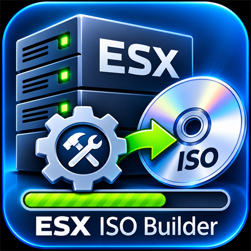

# ESX ISO Builder – Community Edition

A small container with a web UI that turns a list of hosts into **one bootable, fully unattended ESX installer ISO per host**: static management IP and VLAN, root password (hashed), boot disk, NTP, DNS, hardware-specific tuning and optional NVMe memory tiering – all from a CSV and a profile file.

> Community project, not affiliated with or supported by Broadcom/VMware. The generated kickstart **wipes all local disks** of the host it boots. See [DISCLAIMER.md](DISCLAIMER.md).

```
 CSV + profiles.yaml ──► KS.CFG per host ──► <host>-<version>.iso (BIOS + UEFI) ──► download / virtual media URL
        ▲ web UI                                                                      │
        └────────── /api/inventories/<inv>/ansible (inventory for your own automation) ◄┘
```

## Features

- **Web UI** with inventories (CSV), a host editor with live validation and a **DNS check** (A, PTR, CNAME), kickstart preview, build per host or all, ISO library, profiles editor, backup/restore.
- **No ISO extract/rebuild.** `xorriso` copies the original image and replays its own El Torito boot records (BIOS + UEFI), adding only `KS.CFG` and the patched `BOOT.CFG` files – keeps working when the ISO layout changes. Each build verifies the KS and both boot entries.
- **Profiles per hardware type** (`profiles.yaml`): NTP, advanced and kernel settings, `/etc/vmware/config` lines, boot options, firstboot commands. Effective setting = `defaults ← profile ← CSV cell`.
- **Version as a choice:** the `Version` column picks the base ISO; *Build with* overrides it for one run. Built ISOs carry the version in their name.
- **Installer network via boot options:** the installer gets the static IP/VLAN directly – no DHCP needed on the management VLAN.
- **NVMe memory tiering** (ESX 9.1+ `esxcli memtier`, older `tierdevice`), only on an unambiguous, partition-free disk – never guessed.
- **No clear-text root password** in the ISO (`rootpw --iscrypted`, SHA-512).
- **ISO download for BMC virtual media** (iDRAC, KVMs): HTTPS on the UI port, optional fast **media-only plain-HTTP** listener with an allow-list for the BMC subnet.
- **Ansible inventory export** with IP, FQDN, BMC address, ISO URL, SHA-256 and the post-install settings.
- **Backup/restore** of the configuration with automatic restore points.

Example profiles are included for **Dell PowerEdge R640** (BOSS boot) and **Minisforum MS-A2** (Ryzen 9 9955HX: entropy, RDSEED mask, Intel X710 LLDP/LRO/TSO). Demo inventories use `example.com`.

## Quick start

```bash
git clone https://github.com/gertvangorp/ESX-ISO-Builder-CE.git && cd ESX-ISO-Builder-CE
cp .env.example .env && chmod 600 .env && vi .env      # root password, UI + media passwords, PUBLIC_URL
mkdir -p data/iso certs && sudo chown -R 10001:10001 data
docker compose up -d --build
```

Open `https://<host>:8443/` (plain HTTP until you add a certificate). On the first start two demo inventories and `profiles.yaml` are copied into `data/` – replace them with your own hosts.

- **Base ISOs:** download the ESX installer ISO (or a vendor/custom image) from the Broadcom support portal and upload it in *ISO library* or copy it to `data/iso/`. The file name must contain the version you put in the CSV (e.g. `ESX-9.1.1.0.25714478-custom.iso`).
- **TLS:** put leaf + intermediates in `certs/server.crt` and the key in `certs/server.key` (owned by uid 10001, mode 400), then `docker compose restart`.
- **Fast media download (optional):** set `MEDIA_HTTP_PORT=8080`, `MEDIA_URL=http://<fqdn>:8080` and `MEDIA_HTTP_ALLOW=<BMC subnet>` in `.env` and publish the port. iDRAC9 does not log in on plain HTTP, hence the allow-list.
- Run it on a Docker host **outside** the clusters it rebuilds, on the management network.

## CSV columns

| Column | Meaning |
|---|---|
| `Name` | Short hostname – must match the first label of `Hostname` |
| `Enabled` | `yes`/`no` – *Build all* skips `no` |
| `Profile` | Key in `profiles.yaml` (`dell-r640`, `ms-a2`, …) |
| `Version` | ESX build, e.g. `9.1.1.0.25714478` – exactly one base ISO must contain it in its file name |
| `Hostname` | FQDN. VCF needs an A **and** a PTR record (the host editor checks both live) |
| `VMnic`, `VLANID` | Management uplink and VLAN (`0` = untagged). Empty VMnic → profile |
| `IP`, `Mask`, `Gateway` | Management IP. Validated: gateway in subnet, no duplicates |
| `DNS` | 1–2 servers, `;` separated |
| `NTP` | `;` separated; empty → profile default |
| `BootDisk` | **Full** model string for `install --firstdisk=` (e.g. `DELLBOSS VD`, `FIKWOT FN955 1TB` – a part like `FIKWOT` does not match), or `disk:<device id>` for an exact device |
| `TierDisk` | Empty = no tiering. Otherwise the **serial** of the NVMe tier device on that host (last part of its `t10.NVMe____…` id) |
| `TierPct` | Tier size in % of DRAM (1–400), empty → profile (100) |
| `BmcType`, `BmcAddress` | `idrac` / `comet` / `none` and its FQDN – exported for automation |
| `Notes` | Free text |

Find models and ids on a running host or in the installer console (Alt+F1, `root`, empty password):

```bash
esxcli storage core device list | grep -E '^(t10|naa|eui|mpx)|Model:'
```

## What the kickstart does

1. `clearpart --alldrives` – every local disk is wiped (boot, tier and vSAN disks). Use `clearpart: bootdisk` in a profile to wipe only the boot disk.
2. `install --firstdisk=… --overwritevmfs --ignoreprereqwarnings` (no `--overwritevsan`: the installer aborts when the boot disk is not a vSAN disk).
3. Static management network, VLAN, FQDN, DNS; no *VM Network* port group.
4. Installer boot options with the same static network (`installer_network`), so it never waits for DHCP.
5. **First boot** – *not on UEFI Secure Boot hosts* (ESX skips `%firstboot` there; `kickstart.log` says so): FQDN and search domain, NTP (verified, with fallback), SSH only if the profile says so, advanced and kernel settings, `/etc/vmware/config` lines, extra commands, NVMe tiering, a new self-signed certificate with CN = FQDN, then `auto-backup.sh` and a reboot. On Secure Boot hosts set `use_firstboot: false` and apply the settings afterwards (the Ansible inventory export lists them).
6. Firstboot log: `/var/log/esx-firstboot.log` and syslog (`grep esx-firstboot /var/log/syslog.log`).

### MS-A2 profile (Ryzen 9 9955HX / Zen 5)

| Setting | Why |
|---|---|
| kernel `entropySources=2` | RDRAND instead of the slow Zen 4/5 RDSEED (high CPU, `Out of entropy` in vmkernel.log) – [source](https://williamlam.com/2026/04/quick-tip-high-cpu-utilization-on-esx-due-to-slow-entropy-from-amd-zen-4-cpus.html) |
| `cpuid.7.ebx = "-------------0------------------"` | Masks RDSEED from the VMs – [source](https://williamlam.com/2026/09/vcf-9-1-1-reducing-cpu-utilization-on-amd-ryzen-zen4-zen5-by-masking-the-rdseed-instruction.html) |
| `monitor_control.disable_apichv = "TRUE"` | Needed with NVMe memory tiering on Ryzen |
| `cpuid.brandstring = "AMD EPYC Ryzen 9 9955HX"` | Passes the NSX Edge CPU check on consumer Ryzen |
| i40en `LLDP=0,…` | X710 firmware LLDP agent off, one value per port counted on the host – [source](https://www.v-consult.be/ms-a2-x710-lldp-vcenter/) |
| `/Net/TcpipDefLROEnabled 0`, `/Net/UseHwTSO 0` | X710 hardware LRO/TSO off for vSAN ESA – [source](https://williamlam.com/2026/03/maximizing-vsan-esa-performance-on-minisforum-ms-a2.html) |

## Backup and restore

The **Backup** tab or the API covers `profiles.yaml`, every inventory and the build manifests (not the ISOs, not `.env` – keep `.env` in your password manager). Restore points are taken automatically before every change; restore validates first (dry run). Off-box copy: pull `GET /api/backup` daily with `curl -u admin -H 'X-Builder: 1'`.

## API

All calls use the UI Basic-auth login; calls that change something also need the header `X-Builder: 1`. OpenAPI at `/api/docs`.

| Call | |
|---|---|
| `GET /api/inventories/<inv>` | Hosts + validation + last build |
| `PUT /api/inventories/<inv>/hosts/<name>` | Add/update a host (JSON) |
| `GET /api/inventories/<inv>/hosts/<name>/ks[?version=]` | Kickstart preview |
| `POST /api/inventories/<inv>/build` `{"hosts":[…],"version":"…"}` | Build (job id) → `GET /api/jobs/<id>` |
| `GET /api/inventories/<inv>/ansible` | Ansible inventory |
| `GET /api/dns?name=&ip=` | DNS check (A, CNAME, PTR) |
| `GET /api/backup`, `/api/backups`, `POST /api/restore` | Backup / restore points / restore |
| `GET /media/<host>-<version>.iso` | ISO download (media or UI account) |

## Troubleshooting

See [docs/TROUBLESHOOTING.md](docs/TROUBLESHOOTING.md).

## License

[MIT](LICENSE). See also [DISCLAIMER.md](DISCLAIMER.md) and [THIRD_PARTY_NOTICES.md](THIRD_PARTY_NOTICES.md).
